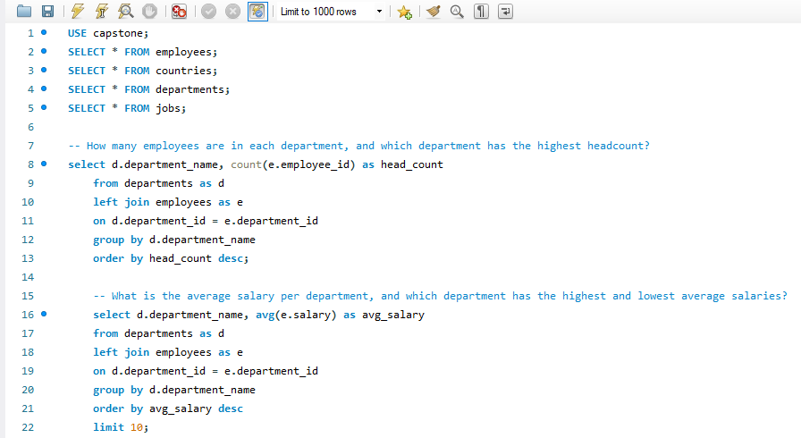

## ORION DATA SYSTEMS PERFORMANCE REPORT

## Executive Summary
This analysis takes into interest the performance of the workforce of the Orion Data systems. It provides clear insights on: workforce distribution, salary comparison, salary bands, and many other analysis. The company is a multinational consulting and technology firm across Europe, giving it the large number of employees it has, making this analysis needed
## Business Context
The HR and Strategy team needs insights from their workforce database to support decision making. The company being one that employs lots of professionals across multiple departments and job roles, the analysis is needed to look into the workforce of their employees. 
## Objectives
The analysis answers the following key questions:
-	How many employees are in each department and which department has the highest headcount?
-	What is the average salary per department, and which department has the highest and lowest average sales?
-	All employees whose salaries are greater than the company’s wide average salary?
-	Identifying all countries in which the Orion data system operates and finding out how many department are in each location
## Data Overview
The analysis is done on datasets from four different tables namely; jobs, employees, departments and countries. The employees table is a bridge table connecting all four tables together and it has 11 columns and 207 rows. The countries table has 3 column an 24 rows. The datasets shows the employee id, employee name, phone number, salary, department and other infirmations.
## Query Preview

## Data Cleaning and Transformation
-	A new schema was created and named capstone
-	All four tables were carefully imported into the schema
## Key Findings
-	It was found out that the business didn’t have any job roles that didn’t have an employee. This means every job role in the company have at least on employee
## Detailed Findings and Analysis 
### Workforce distribution
-	The Shipping department has the highest headcount having 45 employees
-	The Sales department comes next having a headcount of 34 employees
-	Finance and Purchasing department has a headcount of 6 employees, while some other departments have no employees.
### Salary Comparison
-	The Executive department has the highest average salary of 19333.3333 in amount.
-	The Accounting and Public relations department comes next having 10150 and 10000 respectively in amount.
-	The Purchasing department has the lowest average salary of 4150 in amount.
### Salary Band for Employees
-	49 employees fall under the low salary band meaning they earn less than 5000
-	43 employees fall under the medium salary band meaning they earn a salary between 5000 and 10000.
-	Only 15 employees fall under the high salary band, earning a salary higher than 10000.
### Country Level Analysis
Orion data systems operates on a multinational level and they have different employees across different countries from Europe to Africa
-	In Switzerland, the company has 5 departments there
-	In the United States of America, 4 departments
-	In Zimbabwe, 2 departments; Nigeria, 1 department and across all other European countries like that.
### High Earners
-	The company has a wide average salary of 6461 in amount and some employees earn more than the average salary.
-	Employee Steven King earns 24000 for his salary, Neena Kochar and Lex De Haan earn 17000 which is also high and other listed employees have a salary greater than the wide average salary of the company.
### Job Role Analysis
-	The President has an average salary of 24000.
-	The Administration Vice President ha an average salary of 17000.
-	The Marketing manager has 13000 and the Sales Manager has 12200.
### Salary Growth Trend
-	Switzerland has the highest total salary cost of 75100
-	Coming after Switzerland is Italy having 52100 and other countries also have their total salary cost listed.
-	The country with the lowest salary cost is United Kingdom having just 2200
### Workforce Gaps
This wants to show the job roles in the company that do not have any employees. There are no job titles in the company that do not have any employees, All job titles have an employee.
## Tools Used
MySQL was used for the whole analysis
## Conclusion
The analysis provides valuable insights into Orion Data Systems’ workforce distribution, salary structure, and geographical operations. The Shipping department has the highest headcount, while the Executive department has the highest average salary. Switzerland records the highest total salary cost. These findings can help the company improve workforce planning, manage salary expenses, and make informed strategic decisions.
